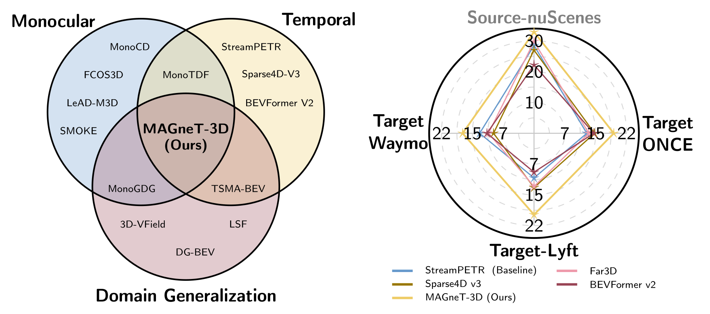

<div align="center">
<h1>MAGneT-3D</h1>
<h3>Monocular And Domain-Generalizable Temporal 3D Detection</h3>

Mohamed Kotb\*, Johannes Michael Meier\*, Christoph Reich, Oussema Dhaouadi, Luis Denninger, Daniel Cremers

<sub>\* equal contribution</sub>

[](https://arxiv.org/abs/2608.14282)
[](https://mo-sameh.github.io/MAGneT-3D-Project-Page/)
[](https://github.com/mo-sameh/MAGneT-3D-Benchmark)
[](LICENSE)
</div>

<p align="center"></p>

MAGneT-3D detects objects in 3D from a monocular video and generalizes to unseen datasets. It
builds on [StreamPETR](https://github.com/exiawsh/StreamPETR) and replaces its static queries with
anchors from a Domain-Robust Anchor Generator (**DRAG**), refined by Temporal Refinement and
Identity Merging (**TRIM**).

- **DRAG** derives 3D proposals from each image at inference time, instead of static learnable queries
  that fit the field of view of the training data.
- **TRIM** refines the proposals over time and merges detections of the same object by identity,
  reducing the dependence on specific proposals.
- **Cross-dataset benchmark**: train on one of nuScenes, Waymo and Lyft, evaluate zero-shot on
  nuScenes, Waymo, Lyft and ONCE.

## Getting started

1. [Environment setup](docs/setup.md)
2. [Data preparation](docs/data_preparation.md)
3. [Training and evaluation](docs/training_inference.md)

## Cross-dataset benchmark

Each model is trained on one dataset and evaluated on the validation sets of nuScenes, Waymo, Lyft
and ONCE (front camera). We report mAP / NDS (%), with NDS without the velocity term; *Avg. cross* is
the mean over the three unseen datasets. The best result per training dataset is in **bold**, the
second best <ins>underlined</ins>. The metric is in the
[benchmark repository](https://github.com/mo-sameh/MAGneT-3D-Benchmark).

| Method | Train | nuScenes | Waymo | Lyft | ONCE | Avg. cross |
|:---|:---:|:---:|:---:|:---:|:---:|:---:|
| StreamPETR | nuScenes | 26.5 / 31.7 | 4.8 / <ins>13.9</ins> | 5.0 / 13.4 | 8.2 / 14.5 | 6.0 / <ins>13.9</ins> |
|  | Waymo | 4.2 / <ins>10.3</ins> | <ins>34.5</ins> / 41.7 | 0.8 / <ins>10.5</ins> | <ins>5.4</ins> / 10.7 | 3.4 / <ins>10.5</ins> |
|  | Lyft | 1.0 / 5.9 | 0.0 / 4.7 | 27.8 / 35.4 | 5.4 / 11.6 | 2.1 / 7.4 |
| Sparse4D v3 | nuScenes | 24.8 / 30.7 | 4.4 / 9.7 | <ins>8.6</ins> / 13.9 | <ins>11.1</ins> / <ins>16.8</ins> | <ins>8.0</ins> / 13.5 |
|  | Waymo | <ins>4.9</ins> / 10.1 | 32.8 / <ins>42.3</ins> | <ins>2.0</ins> / 8.0 | 4.8 / 9.5 | <ins>3.9</ins> / 9.2 |
|  | Lyft | <ins>2.2</ins> / 6.6 | 1.5 / 6.3 | <ins>32.0</ins> / **40.6** | 3.8 / 8.3 | 2.5 / 7.1 |
| Far3D | nuScenes | **28.3** / <ins>33.5</ins> | 2.3 / 12.1 | 5.6 / <ins>14.6</ins> | 9.3 / 14.2 | 5.7 / 13.6 |
|  | Waymo | 1.9 / 8.3 | **36.9** / **43.8** | 0.3 / 7.8 | 2.6 / 8.4 | 1.6 / 8.1 |
|  | Lyft | 1.3 / <ins>8.2</ins> | 1.1 / 8.9 | 31.0 / 36.6 | <ins>6.8</ins> / 11.6 | 3.0 / <ins>9.6</ins> |
| BEVFormer v2 | nuScenes | 21.8 / 24.1 | <ins>6.2</ins> / 11.6 | 2.5 / 9.7 | 10.6 / 16.3 | 6.4 / 12.5 |
|  | Waymo | 2.1 / 6.5 | 11.5 / 18.2 | 1.8 / 8.7 | 5.2 / <ins>10.9</ins> | 3.0 / 8.7 |
|  | Lyft | 1.4 / 4.7 | <ins>3.8</ins> / <ins>10.9</ins> | 19.4 / 28.1 | 5.5 / <ins>12.1</ins> | <ins>3.6</ins> / 9.2 |
| **MAGneT-3D** | nuScenes | **28.3** / **35.0** | **11.2** / **19.6** | **15.6** / **21.8** | **12.0** / **18.7** | **12.9** / **20.0** |
|  | Waymo | **11.1** / **20.7** | 32.9 / 41.5 | **12.2** / **24.3** | **8.7** / **14.5** | **10.7** / **19.8** |
|  | Lyft | **4.4** / **10.6** | **6.4** / **13.3** | **33.5** / <ins>37.9</ins> | **8.0** / **12.2** | **6.3** / **12.0** |

The baselines are retrained in the monocular video setting as described in the paper. The MAGneT-3D
models are re-trained with this code.

## Model zoo

| Model | Train | Config | Download |
|:---|:---:|:---:|:---:|
| MAGneT-3D | nuScenes | [config](projects/configs/magnet3d/magnet3d_r50_nuscenes.py) | [model](https://drive.google.com/file/d/1wUgpR-H0yXLU31K-6ID0cTfbRI4ifoek/view?usp=sharing) |
|  | Waymo | [config](projects/configs/magnet3d/magnet3d_r50_waymo.py) | [model](https://drive.google.com/file/d/1YMCelHIvMtZqykC7-tK8Xk1yz1yweHks/view?usp=sharing) |
|  | Lyft | [config](projects/configs/magnet3d/magnet3d_r50_lyft.py) | [model](https://drive.google.com/file/d/1aPPYOLwDBiMIA4P8UiePhOFUX6MVsJQR/view?usp=sharing) |
| StreamPETR | nuScenes | [config](projects/configs/streampetr/streampetr_r50_nuscenes.py) | [model](https://drive.google.com/file/d/1iYwaHrusI5EpnqtNsrkdFJE4sW2lyuBj/view?usp=sharing) |
|  | Waymo | [config](projects/configs/streampetr/streampetr_r50_waymo.py) | [model](https://drive.google.com/file/d/1j2OI1QTjXfqfMS3zqvIYmGY5AAsuNm3j/view?usp=sharing) |
|  | Lyft | [config](projects/configs/streampetr/streampetr_r50_lyft.py) | [model](https://drive.google.com/file/d/18NnXlyR5uYMeYieJv3L7dVtQDG50A9qt/view?usp=sharing) |

Download the checkpoints into `ckpts/`.
The checkpoints of Table 2 in the paper and their evaluation configs are in [table2/](table2/README.md).

## Repository structure

```
projects/
  configs/
    magnet3d/        MAGneT-3D configs, one per training dataset
    streampetr/      monocular StreamPETR baselines
    _base_/          shared runtime, model and evaluation (test set) definitions
  mmdet3d_plugin/
    models/detectors/magnet3d.py           MAGneT3D detector
    models/dense_heads/drag_head.py        DRAG
    models/dense_heads/magnet3d_head.py    temporal query head with TRIM
    core/bbox/assigners/soft_top_k_assigner_3d.py   TRIM soft assignment
    core/bbox/coders/nms_free_coder.py     TRIM identity-based deduplication
    datasets/mono_dataset.py               monocular video dataset
table2/          configs and checkpoints to reproduce Table 2 of the paper
tools/
  train.py, dist_train.sh, slurm_train.sh  training
  eval_cross_dataset.py                    evaluation on all benchmark datasets
```

## Acknowledgements

This code is built on [StreamPETR](https://github.com/exiawsh/StreamPETR),
[MMDetection3D](https://github.com/open-mmlab/mmdetection3d) (including FCOS3D),
[PETR](https://github.com/megvii-research/PETR) and the
[nuScenes devkit](https://github.com/nutonomy/nuscenes-devkit). We thank the authors for
releasing their code.

## Citation

```bibtex
@article{kotb2026magnet3d,
  title   = {MAGneT-3D: Monocular and Domain-Generalizable Temporal 3D Detection},
  author  = {Kotb, Mohamed and Meier, Johannes and Reich, Christoph and
             Dhaouadi, Oussema and Denninger, Luis and Cremers, Daniel},
  journal = {arXiv preprint arXiv:2608.14282},
  year    = {2026}
}
```
